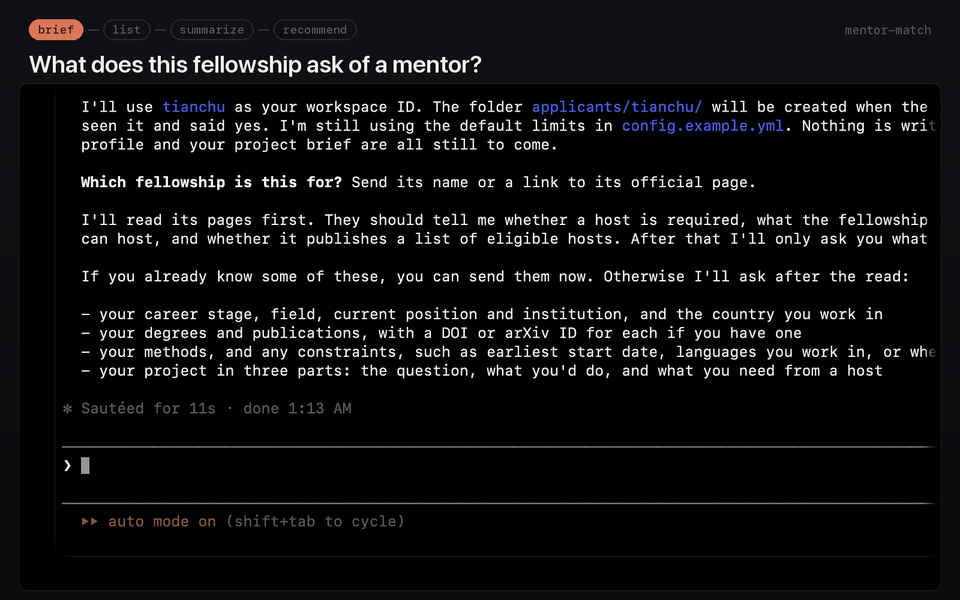

# mentor-match

Find the mentors a fellowship asks you to name.

Version 0.1.0, the first public release. A file-based workflow for coding agents, with shared skills and offline Node.js checks.

Many fellowships and programmes put a named mentor or host between you and the application. Some will not accept an application until that person has agreed. Others publish a list of people to choose from, or expect you to write to someone before you apply, without requiring a commitment. Either way you face the same work: finding the people who could host your project, reading what each of them works on now, and deciding who to write to and why. There is no tool for it.

> [!TIP]
> **New to GitHub or the terminal? Hand the link to an AI.** Paste this into any AI assistant (ChatGPT, Claude, Gemini, …), and it will walk you through the [Quick start](#quick-start) on your own computer:
>
> ```text
> I want to use https://github.com/TianCZeng/mentor-match. Read its
> Quick start, then teach me step by step how to install it and start my
> first run.
> ```
>
> Stuck on a step later, or seeing an error you don't understand? Paste it into the same chat.



<p align="center"><em>▶ Full-quality video below (~52s) · host candidates' names are masked</em></p>

https://github.com/user-attachments/assets/c4c954cb-ab45-40fb-bc39-8db4f8824c5f

**Sample output.** [`examples/recommendation-valid.md`](examples/recommendation-valid.md) is a recommendation about invented people, with the [pool](examples/pool-valid.md) and the [summaries](examples/summaries-valid.md) it was written from.

## Quick start

You need:

- an agent that can read and write local files, run commands, search the web, and retrieve pages and bibliographic records;
- Node.js 22 or later, and git;
- macOS or Linux. On Windows, use WSL: the Claude skill links and a containment test use symlinks, which a plain Windows checkout may not keep.

First time with any of these? Paste the prompt from the [tip at the top](#mentor-match) into any AI assistant.

```bash
git clone https://github.com/TianCZeng/mentor-match.git
cd mentor-match
npm ci            # installs the one dependency, js-yaml
npm run verify    # optional: checks the clone, offline
```

Start your agent inside the `mentor-match` folder, not a parent folder: it loads this repository's skills from the folder it starts in. The workflow is the same whichever invocation it supports:

| Agent | Start `brief` |
|---|---|
| [Claude Code](https://claude.com/claude-code) | Launch `claude`, then enter `/mentor-match brief` |
| [Codex CLI or IDE](https://learn.chatgpt.com/docs/build-skills) | Open this repository, then enter `$mentor-match brief` |
| Another agent, or no skill discovery | Give it the prompt below |

```text
Read AGENTS.md and .agents/skills/mentor-match/SKILL.md, then run brief mode.
```

Give it the fellowship's URL and a few sentences about your project. It reads the fellowship's own pages, asks for what it still lacks, and writes your brief. To have it read a CV or a proposal, put the file under `applicants/<your-id>/`, for example `applicants/jane/cv.pdf`: everything under `applicants/` is gitignored. A file at the repository root is not, so `git add .` would commit it.

`config.yml` is optional. Without it, the caps in `config.example.yml` apply; copy that file to `config.yml` to change one.

## What it does

It answers three questions, for one fellowship at a time:

1. **Who could host me?** A pool of host candidates: the people whose work could host your project and whom the fellowship's rules admit. It reads the fellowship's own published host list where it has one. Where the rules also admit people on no list, such as anyone at the university working on the subject, it reads the eligible departments' and centres' own people pages as well. Every source considered is listed with its outcome, every person screened out carries the reason and the page it rests on, and nothing enters the pool from a directory or a ranking site.
2. **Who is each of these people?** A summary per host candidate: what their group says it works on, in the group's own words; what they have published as first or last author recently; what of that touches your project; and what could not be established. Every substantive sentence cites a page or a publication identifier you can open.
3. **Who should I write to, and why?** Two judgements per host candidate, kept apart: `fit`, whether their published work connects to your project, and `host_strength`, whether this is a host worth applying with under this fellowship's rules. Each has its own reasons and the pages they rest on. It proposes a set of the size the fellowship asks for, and you keep or drop each entry.

Ask the agent to use `mentor-match` with one of these inputs. These are requests to the agent, not shell commands; use its skill syntax above or plain language.

| Input | What it does |
|---|---|
| No mode | Where you are, and the next step |
| `brief` | What the fellowship asks of a host, and what you are proposing |
| `list` | Build the pool of people who could host you |
| `summarize` | What each host candidate works on, with every claim sourced |
| `recommend` | Fit and host strength, with reasons; keep or drop |
| An official URL | Add one person from their own page |

## What a run takes

- **Time and pages.** `list` is the long step. On real runs it opened about 110 pages and took 20 to 25 minutes of agent time. `summarize` made about 2 requests to a publication index per host candidate. `recommend` opens nothing unless a rule needs re-reading. The caps in `config.example.yml` (120 page opens, 20 web searches and 60 index requests per run) end a run; whatever is left unopened is named in the report and read on the next run.
- **What your agent must be able to do.** The agent must be able to inspect redirects before following them, so a new domain passes the gate before it is fetched. A tool that automatically follows redirects without that control cannot supply the page; the run reports the gap. The full capability contract is in [`modes/_shared.md`](modes/_shared.md). Subagents are optional; units can be read sequentially.
- **Permissions.** Your agent controls command, file and network access. The three checking commands run offline and never write; the agent needs file writes for reports and web access for research. Permission prompts vary by agent and local settings, and never replace the domain gate.

  **Claude Code:** the committed `.claude/settings.json` allows only the three guards. To allow its web tools in your clone, merge these entries into `.claude/settings.local.json`, which is gitignored:

  ```json
  {
    "permissions": {
      "allow": ["WebFetch", "WebSearch"]
    }
  }
  ```

  **Codex and other agents:** use their own permission controls. The Claude settings have no effect on them. Codex CLI and IDE configuration lives in `config.toml`; see its [configuration documentation](https://learn.chatgpt.com/docs/config-file/config-basic). This repository ships no permission override for those agents.
- **Which universities cost an extra step.** A page about a person counts as official without a check when its domain ends in `.edu`, `.ac.uk`, `.edu.au`, `.ac.nz`, `.edu.sg`, `.edu.cn`, `.ac.jp`, `.ac.kr`, `.edu.hk`, `.edu.tw` or `.ac.in`, whose registries admit only educational and research institutions, or when it belongs to one of the 108 institutions in `registry/institutions.seed.yml`. A university on any other domain, such as `hku.hk` or `mpg.de`, costs the run one more page: the agent ties the domain to the institution from outside it before reading facts there, and the pool report lists that tie for you to check.

## Between steps

`brief`, `list`, `summarize` and `recommend` run in that order, because each reads what the one before it wrote. They read it from files in your clone, not from the conversation, so you can start a fresh session between any two of them, or close your agent and come back another day. Clearing is worth doing: `list` alone opens over a hundred pages, and the next step needs none of them in the conversation. Ask for `mentor-match` with no mode to see where you are, and a bare command answers in the language of your brief.

Stay in the session in two places: while `brief` is still asking you something, and after `recommend`, until you have said which entries to keep or drop.

## What it will not do

It does not say who will accept. Nothing in it estimates that.

- No probability, no rank, and no score combining the two judgements. A host candidate can be a close fit at a small group and a loose fit at a large one, and those are different applications; one number would hide the difference.
- No guess about whether someone is recruiting or has space. `availability` is recorded only where a page states it, with the sentence quoted; otherwise it is `unknown`, which is the normal case and never removes anyone.
- No unsourced reputation claim, and no journal impact factor. A citation metric is recorded only with the database that produced it and the date it was read, and it may support `host_strength` — never `fit`. A citation count does not say whether two research questions meet.

## What it records about a person, and what it refuses to

This tool builds a local file of named people who did not agree to be catalogued. That is the part of it that can do harm, so the boundary is written out in full in [`AGENTS.md`](AGENTS.md) under **Personal Data**, and it is the section to read first.

The short form. A record holds the name as the institution publishes it, the institution and unit, the role title in the page's own words, the page it was read from and the date, a contact address the institution publishes for professional contact, `availability` where a page states it, the publication records read, and citation metrics with their source and date. That is the whole list, and the schema closes it: a run that found something interesting about a person cannot add a field to keep it.

It records nothing about a private life, no age or demographic, no photograph, no social account, no personal contact route, nothing off a directory or a forum, and nobody who is not a potential host for the fellowship you are working on.

The file is `registry/researchers.yml`. It lives in your clone and it is gitignored. **No file of people ships with this repository and none ever will** — an institution's domain is a public fact about an organisation, and a researcher row is not. The cost is that every clone builds its own pool from scratch, with no warm start. That cost is accepted.

**What names a person, and how to remove it.** Deleting `registry/researchers.yml` removes the facts, but a name is kept in other places too:

| Where | How to remove it |
|---|---|
| `registry/researchers.yml` | Delete the person's row, or the whole file |
| The pool, summaries and recommendation reports, with their machine records, under `applicants/<your-id>/<fellowship-id>/` | Delete the person's entries, or the reports |
| Earlier versions of those files, in each folder's `.history/` | Delete the copies |
| Your agent's session history, which holds the pages it read | Delete the sessions in the agent's own folder: Claude Code keeps them under `~/.claude/projects/`, Codex under `~/.codex/sessions/` |
| Your model provider | What it keeps is set by its own terms; check its privacy and data-retention settings |

Doing this in one step is on the [roadmap](#roadmap).

## It does not integrate with other tools

Everything lives in your own clone. `mentor-match` reads nothing from another tool and writes nothing into one: the fellowship's rules are recorded here, in this repository's own files, no script resolves a path outside this root, and there is no configuration key naming another checkout.

The cost is that a fellowship you already track in another tool, such as an application tracker, is recorded again here, and the hosts it recommends go into no other tool. That is the price of keeping it self-contained.

## How it works

The shared instructions live in `AGENTS.md`, `.agents/skills/` and `modes/`. Codex discovers the skills in `.agents/skills/`; Claude Code reaches the same files through `.claude/skills/` symlinks. An agent without skill discovery can read the router directly. A thin layer of Node code does the checks that must never be a matter of prose — which sites count as official, the schemas, the banned claims, the joins between files — and everything is stored as plain files in your own clone. There is no server, no account, and no telemetry.

Reports are written in the language you use. Each report's machine-readable record sits beside it, under `machine/`, and is English, because the checks read it. A person's name, their unit, and their role title keep the form their own page published them in.

## Words this tool uses

| Word | Meaning |
|---|---|
| host candidate | Someone who could host your project under the fellowship's rules. Never just "candidate", which fellowships use for you |
| pool | The run's list of host candidates, with everyone screened out and why |
| unit | A department, institute or centre whose own people page is read |
| official page | A page on the institution's own domain, or the fellowship's own page |
| linked site | A lab or personal site that an official page links to for that person. It may fill a field the official pages lack |
| lead | A directory, ranking site, search result or profile aggregator. It can say someone exists, never a fact about them |
| evidence basis | What a judgement rests on: `official`, `linked`, `bibliographic` (a publication record) or `inferred` (general knowledge, never enough alone for `strong`) |
| guard | One of the three offline checking commands, `doctor`, `validate` and `gate`. A guard rejects a bad file; it never rewrites it |
| gate | The guard that decides whether a URL's domain may supply a fact about a person |
| machine record | The English YAML file beside each report, which the guards read |
| user layer | Your own files: `config.yml`, `applicants/`, `fellowships/` and the two local registries. All gitignored |
| facts layer | `registry/researchers.yml`: what was read about each person, and nothing else |

## Roadmap

This release does the four steps — `brief`, `list`, `summarize` and `recommend` — with the three guards, `doctor`, `validate` and `gate`.

Not built yet, in no set order and with no date, each waiting on real use:

- drafting the first-contact email and the paragraph on research fit, from the evidence the summary and the two judgements already carry, for you to review before anything is sent;
- re-checking, before you write, whether a host candidate is still eligible under the fellowship's rules, whether their unit says it is taking people, and whether their page has changed since the pool was built;
- removing one person from the local files and from every report that names them;
- recording who replied, who agreed and who declined, and how the two judgements held up against that.

## Reading order

[`AGENTS.md`](AGENTS.md) is the policy, written for the agent that runs the tool. As a person, read its **Personal Data**, **Sources and Trust** and **The Two Judgement Axes**. [`DATA_CONTRACT.md`](DATA_CONTRACT.md) says what lives where, and what each of the four layers never holds. [`modes/`](modes/) holds one contract per mode. Changes: [`CHANGELOG.md`](CHANGELOG.md). Contributions: [`CONTRIBUTING.md`](CONTRIBUTING.md). Security problems, and personal data exposed by accident, are reported privately: [`SECURITY.md`](SECURITY.md). Licence: [MIT](LICENSE).

中文说明见 [`README.zh-CN.md`](README.zh-CN.md)。
