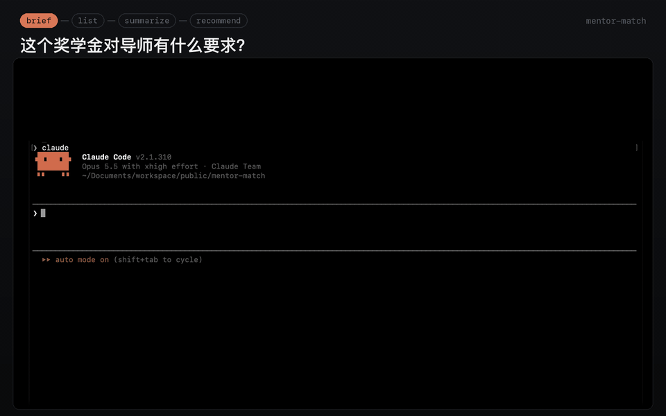

# mentor-match

找到 fellowship 要你提名的导师。

版本 0.1.0，第一个公开版本。供编程 agent 使用的文件工作流，共享 skill 和离线 Node.js 检查。

很多 fellowship 和项目都在你和申请之间放了一位明确的导师或 host。有的在那个人答应之前根本不受理申请；有的公布一份名单让你自己挑，或者希望你先写信联系，但并不要求对方先做出承诺。无论是哪一种，你要做的事情都一样：找出哪些人可能接收你的课题，读懂每个人现在在做什么，再决定写信给谁、为什么。这件事没有现成的工具。

> [!TIP]
> **不会用 GitHub 或终端？把链接交给 AI 就行。** 把下面这段话发给任意 AI 助手（ChatGPT / Claude / DeepSeek / 豆包…），它会在你自己的电脑上一步步带你完成 [快速开始](#快速开始)：
>
> ```text
> 我想用这个工具：https://github.com/TianCZeng/mentor-match
> 请先读它 README 里的快速开始（Quick start），再一步步教我装好并开始第一次使用。
> ```
>
> 之后哪一步卡住了，或者看到看不懂的报错，直接粘贴到同一个对话里问它。



<p align="center"><em>▶ 下方是高清视频（约 61 秒） · 候选人姓名已遮挡</em></p>

https://github.com/user-attachments/assets/66c17480-3feb-4eea-8180-f1939df2ad55

**示例输出。** [`examples/recommendation-valid.md`](examples/recommendation-valid.md) 是一份关于虚构人物的推荐报告（英文），旁边是它所依据的[候选人池](examples/pool-valid.md) 和[小结](examples/summaries-valid.md)。

## 快速开始

你需要：

- 能读写本地文件、运行命令、搜索网页、读取页面和文献记录的 agent；
- Node.js 22 或更高版本，以及 git；
- macOS 或 Linux。Windows 请用 WSL：Claude 的 skill 链接和一项路径边界测试使用符号链接，普通的 Windows checkout 可能保留不了它们。

第一次接触这些？把[页首提示](#mentor-match)里的那段话发给任意 AI 助手。

```bash
git clone https://github.com/TianCZeng/mentor-match.git
cd mentor-match
npm ci            # 安装唯一的依赖 js-yaml
npm run verify    # 可选：离线检查这个 clone
```

在 `mentor-match` 文件夹里启动你的 agent，不要在它的上一级目录启动：agent 从启动时所在的文件夹加载这个仓库的 skill。调用方式可以不同，执行的是同一套工作流：

| Agent | 如何开始 `brief` |
|---|---|
| [Claude Code](https://claude.com/claude-code) | 启动 `claude`，输入 `/mentor-match brief` |
| [Codex CLI 或 IDE](https://learn.chatgpt.com/docs/build-skills) | 打开这个仓库，输入 `$mentor-match brief` |
| 其他 agent，或没有 skill 自动发现功能 | 输入下面这段话 |

```text
请读取 AGENTS.md 和 .agents/skills/mentor-match/SKILL.md，然后执行 brief 模式。
```

给出 fellowship 的网址，再用几句话说明你的课题。它会读 fellowship 自己的页面，问你还缺什么，然后写下你的 brief。想让它读简历或研究计划，就把文件放在 `applicants/<你的 id>/` 下，例如 `applicants/jane/cv.pdf`：`applicants/` 下的一切都被 gitignore。放在仓库根目录的文件不会被忽略，`git add .` 会把它提交进去。

`config.yml` 是可选的。没有它，就用 `config.example.yml` 里的上限；要改某个上限，把那个文件复制成 `config.yml` 再改。

## 它做什么

一次只针对一个 fellowship，回答三个问题：

1. **谁可能做我的 host？** 一个候选人池：工作可能接得住你的课题、并且 fellowship 的规则允许的人。如果 fellowship 公布了合格 host 名单，就读这份名单。如果规则还允许名单之外的人，比如全校研究这个方向的任何教员，就同时去读符合条件的院系和中心自己的人员页面。每一个被考察过的来源都会连同结果一起列出，每一个被筛掉的人都写明原因和所依据的页面，目录站和排名站里的信息一概不进入这个池子。
2. **这些候选人各自是谁？** 每位候选人一段小结：所在的组用自己的话说在做什么；近期以第一作者或末位作者发表了什么；其中哪些与你的课题相关；以及哪些没能查清。每一句实质性的话都引用一个你自己能打开的页面或文献标识符。
3. **我该写信给谁，为什么？** 每位候选人两项判断，彼此分开：`fit`，即其发表的工作与你的课题是否接得上；`host_strength`，即按这个 fellowship 的规则来看，是否值得作为 host 去申请。两项各有自己的理由和所依据的页面。它会按 fellowship 要求的人数提出一组建议人选，每一位留下还是划掉，由你决定。

请 agent 使用 `mentor-match`，并给出下面一种输入。这些是给 agent 的请求，不是终端命令；可以使用上表中的 skill 调用方式，也可以直接用自然语言。

| 输入 | 做什么 |
|---|---|
| 不指定模式 | 你现在在哪一步，下一步是什么 |
| `brief` | 这个 fellowship 对 host 的要求，以及你要提的课题 |
| `list` | 建立可能做你 host 的人的池子 |
| `summarize` | 每位候选人在做什么，每条说法都有出处 |
| `recommend` | fit 与 host_strength，各有理由；留下或划掉 |
| 一个官方网址 | 从某人自己的页面加入一位候选人 |

## 跑一次要花什么

- **时间和网页。** `list` 是最长的一步。在真实运行中，它打开了大约 110 个网页，用了 20 到 25 分钟的 agent 时间。`summarize` 对每位候选人向文献索引发出大约 2 次请求。 `recommend` 除非需要重读某条规则，否则不打开任何网页。`config.example.yml` 里的上限（每次运行 120 次网页打开、20 次网页搜索、60 次索引请求）到了就停；没来得及打开的会在报告里列出，留给下一次运行。
- **你的 agent 必须能做到什么。** Agent 必须能在跟随重定向前检查目标地址，让新域名在被抓取前通过 gate。如果工具只能自动跟随重定向、无法提前检查，就不能用它读取该页面；运行会报告这个缺口。完整的能力要求见 [`modes/_shared.md`](modes/_shared.md)。子 agent 是可选的，院系可以逐一读取。
- **权限。** 命令、文件和网络访问由你的 agent 控制。三个检查命令离线运行，从不写文件； agent 需要写入权限来保存报告，需要联网来查阅来源。是否弹出提示取决于 agent 和本地设置，权限提示不能代替域名 gate。

  **Claude Code：** 仓库里的 `.claude/settings.json` 只放行三个检查命令。想在自己的 clone 里放行网页工具，把下面的条目合并到 `.claude/settings.local.json`（它被 gitignore）：

  ```json
  {
    "permissions": {
      "allow": ["WebFetch", "WebSearch"]
    }
  }
  ```

  **Codex 和其他 agent：** 使用各自的权限设置，Claude 的设置对它们不起作用。 Codex CLI 和 IDE 使用 `config.toml`，见其[配置文档](https://learn.chatgpt.com/docs/config-file/config-basic)。本仓库不为这些 agent 提供权限覆盖配置。
- **哪些大学要多一步。** 关于一个人的页面，如果域名以 `.edu`、`.ac.uk`、`.edu.au`、 `.ac.nz`、`.edu.sg`、`.edu.cn`、`.ac.jp`、`.ac.kr`、`.edu.hk`、`.edu.tw` 或 `.ac.in` 结尾（这些注册机构只接受教育和科研机构注册），或者属于 `registry/institutions.seed.yml` 里的 108 所机构之一，就直接算官方页面。在其他域名上的大学，比如 `hku.hk` 或 `mpg.de`，要多花一个网页：agent 先从域名之外找到一个联系，证明这个域名属于这所机构，才从上面读取事实，候选人池报告会列出这个联系供你核对。

## 步骤之间

`brief`、`list`、`summarize`、`recommend` 要按这个顺序跑，因为每一步都读上一步写下的东西。它们读的是你 clone 里的文件，不是对话记录，所以任意两步之间都可以开一个新会话，或者关掉 agent 改天再来。清一下是值得的：光 `list` 一步就要打开一百多个网页，下一步并不需要这些内容留在对话里。请 agent 使用 `mentor-match` 而不指定模式，它会告诉你现在在哪一步；只敲命令、不写别的话时，它用你的 brief 的语言回答。

有两个时候先别清：`brief` 还在问你问题的时候；以及 `recommend` 之后、你还没说留下或划掉哪几位的时候。

## 它不做什么

它不会说谁会答应。这一点仓库里没有任何东西去估计。

- 没有概率，没有排名，也没有把两项判断合成一个分数。同一位候选人在小组里可能是紧密的 fit，在大组里可能是松散的 fit，这是两份不同的申请；一个数字会把这个差别藏起来。
- 不猜某人是否在招人、是否有空位。`availability` 只在页面上明确写了的时候才记录，并且逐字引用那句话；否则就是 `unknown`——这是常态，而且它永远不会把任何人从池子里去掉。
- 不写没有出处的声誉性说法，也不用期刊影响因子。引用量这类指标只有在同时记下产生它的数据库和读取日期时才会被记录，而且它只能支撑 `host_strength`，绝不支撑 `fit`：引用次数说明不了两个研究问题是否接得上。

## 它记录一个人的什么，又拒绝记录什么

这个工具会在本地建立一份文件，里面是一些并没有同意被收录的、有名有姓的人。这是它最可能造成伤害的地方，所以这条边界在 [`AGENTS.md`](AGENTS.md) 的 **Personal Data** 一节里完整写了出来，也是最该先读的一节。

简短版本。一条记录包含：机构页面上公布的姓名、机构与院系、页面原话写的职位名称、读取的页面地址和日期、机构为公务联系而公布的联系方式、页面明确写出的 `availability`、读到的文献记录，以及带有来源和日期的引用指标。这就是全部，而且 schema 把这个集合封死了：一次运行即使发现了关于某人的有趣信息，也无法为了留下它而新增字段。

它不记录任何关于私人生活的内容，不记录年龄或人口统计特征，不记录照片，不记录社交账号，不记录私人联系方式，不记录来自目录站或论坛的任何东西，也不记录任何不是你正在申请的这个 fellowship 的潜在 host 的人。

这份文件是 `registry/researchers.yml`。它只存在于你自己的 clone 里，被 gitignore。 **这个仓库不附带任何人员名单文件，将来也不会有**——一所机构的域名是关于一个组织的公开事实，而一条研究者记录不是。代价是每个 clone 都要从零建自己的池子，没有现成的起点。这个代价是接受的。

**哪些地方留有一个人的名字，怎么删掉。** 删掉 `registry/researchers.yml` 会删掉事实记录，但名字还留在别的地方：

| 位置 | 怎么删 |
|---|---|
| `registry/researchers.yml` | 删掉这个人的那一条，或者删掉整个文件 |
| `applicants/<你的 id>/<fellowship-id>/` 下的候选人池、小结和推荐报告，以及它们的机器记录 | 删掉报告里关于这个人的条目，或者删掉报告 |
| 这些文件的旧版本，在各自文件夹的 `.history/` 里 | 删掉这些副本 |
| 你的 agent 的会话记录，里面有它读过的网页 | 在 agent 自己的文件夹里删掉这些会话：Claude Code 在 `~/.claude/projects/` 下，Codex 在 `~/.codex/sessions/` 下 |
| 你的模型供应商 | 保留什么由它自己的条款决定；请查看它的隐私和数据保留设置 |

一步完成这些的功能在[路线图](#路线图)里。

## 它不与其他工具集成

一切都放在你自己的 clone 里。`mentor-match` 既不从别的工具读取，也不往别的工具写入： fellowship 的规则记录在这个仓库自己的文件里，没有任何脚本会解析到本仓库根目录之外的路径，也没有任何配置项指向别的仓库。

代价是：你已经在别的工具（比如申请进度表）里跟踪的 fellowship，在这里要再记一遍，它推荐的 host 也不会进入任何别的工具。这是保持本工具自成一体的代价。

## 工作方式

共享指令在 `AGENTS.md`、`.agents/skills/` 和 `modes/` 中。Codex 从 `.agents/skills/` 发现 skill，Claude Code 通过 `.claude/skills/` 下的符号链接读取同一份文件。没有 skill 自动发现功能的 agent 可以直接读取路由文件。一层很薄的 Node 代码负责那些绝不能靠文字表述来保证的检查——哪些网站算官方来源、各项 schema、被禁止的说法、文件之间的连接——其余一切都以普通文件存放在你自己的 clone 里。没有服务器，没有账号，没有遥测。

报告用你使用的语言书写。每份报告旁边有一份机器可读的记录，放在 `machine/` 下，用英文书写，因为检查命令要读它。人名、院系名称和职位名称保持其页面上公布的原样。

## 本工具用到的词

| 词 | 含义 |
|---|---|
| host candidate（候选人） | 按 fellowship 的规则可能接收你课题的人。工具从不单说 "candidate"，因为 fellowship 用这个词指你 |
| pool（候选人池） | 一次运行得出的候选人名单，连同被筛掉的人和原因 |
| unit（院系） | 被读取其人员页面的系、研究所或中心 |
| official page（官方页面） | 机构自己域名上的页面，或 fellowship 自己的页面 |
| linked site（链接站点） | 官方页面为某人链接的实验室或个人网站，可以补上官方页面没有的字段 |
| lead（线索） | 目录站、排名站、搜索结果或资料聚合站。它只能说明某人存在，不能提供关于其本人的任何事实 |
| evidence basis（证据等级） | 一项判断所依据的来源：`official`、`linked`、`bibliographic`（文献记录）或 `inferred`（一般知识，单凭它永远不能判为 `strong`） |
| guard（检查命令） | 三个离线检查命令 `doctor`、`validate`、`gate` 之一。它拒绝不合格的文件，从不改写 |
| gate | 判断一个网址的域名能否提供关于某人的事实的检查命令 |
| machine record（机器记录） | 每份报告旁边的英文 YAML 文件，供检查命令读取 |
| user layer（用户层） | 你自己的文件：`config.yml`、`applicants/`、`fellowships/` 和两个本地登记表，全部被 gitignore |
| facts layer（事实层） | `registry/researchers.yml`：关于每个人读到了什么，此外什么都没有 |

## 路线图

这个版本做的是四步——`brief`、`list`、`summarize`、`recommend`——加上三个检查命令： `doctor`、`validate`、`gate`。

以下还没有做，不排先后，也不定日期，都要等真实使用之后再说：

- 根据小结和两项判断里已有的证据，起草第一封联系邮件和说明研究契合的段落，发出之前由你审阅；
- 在你写信之前复核：候选人按 fellowship 的规则是否仍然合格，所在院系是否说明正在招人，以及建池之后其页面有没有变化；
- 从本地文件以及每一份提到某个人的报告里，删除这个人；
- 记录谁回了信、谁同意、谁拒绝，以及两项判断与结果对照下来是否站得住。

## 阅读顺序

[`AGENTS.md`](AGENTS.md) 是策略，写给运行这个工具的 agent 看。作为读者，请读其中的 **Personal Data**、**Sources and Trust** 和 **The Two Judgement Axes** 三节。 [`DATA_CONTRACT.md`](DATA_CONTRACT.md) 说明什么放在哪里，以及四层各自绝不存放什么。 [`modes/`](modes/) 每个模式一份契约。版本变化见 [`CHANGELOG.md`](CHANGELOG.md)。参与贡献见 [`CONTRIBUTING.md`](CONTRIBUTING.md)。安全问题，以及个人数据的意外泄露，请私下报告，见 [`SECURITY.md`](SECURITY.md)。许可证：[MIT](LICENSE)。

English: [`README.md`](README.md)。
